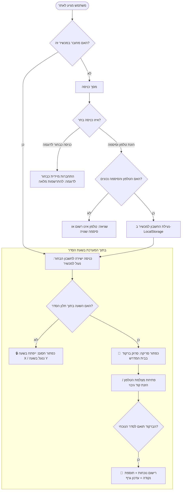

# מסמך איפיון טכני ומערכתי: מערכת בקשו VIBE ההרמטית

> **סטטוס:** גרסה סופית מאושרת ומיושמת  
> **מערכת:** בקשו VIBE (ישיבת בקשו ירושלים)  
> **גרסה:** 2.0 (הרמטית ומבודדת)  
> **תאריך:** אוקטובר 2026  

---

## 1. תקציר מנהלים וארכיטקטורה כללית

פלטפורמת "בקשו VIBE" עברה שדרוג יסודי ממערכת פתוחה למערכת מבצע סגורה והרמטית:
1. **הפרדת רשויות מוחלטת**:
   * **פורטל ראש הישיבה (`admin.html`)**: דף ניהול עצמאי ומבודד לחלוטין המוגן בסיסמת מנהל.
   * **עמוד הבחורים (`index.html`)**: אינו כולל שום קישור, לשונית או רמז לקיומו של ממשק ניהול.
2. **מסך כניסה מאובטח (Blind Login)**:
   * אין תפריט נגלל של שמות (מונע מגורם זר לדעת מי לומד בישיבה).
   * כניסה באמצעות **מספר טלפון וסיסמה אישית**.
   * **כפתור ייעודי: "👁️ כניסה מהירה כבחור לדוגמה"**: מאפשר לכל אורח, סקרן או הורה להיכנס בלחיצה אחת לפרופיל הדגמה מלא ("ישראל ישראלי") ולהתרשם מכל יכולות המערכת.
3. **נעילה למכשיר (קביעת סיסמה פעם אחת)**:
   * הבחור מקבל קישור אישי בסמס (`/?invite=ID`), קובע סיסמה פעם אחת, והמכשיר ננעל לחשבונו.
   * **נמחק כפתור "החלף בחור"** – אין אפשרות לצאת ולהתחזות לבחור אחר.
4. **גרף התקדמות בראש לוח המבצע**:
   * **גרף ויזואלי ודינמי בראש העמוד** המציג את קצב צבירת הנקודות, אחוזי נוכחות יומית ומרחק מ-3 היעדים (ארד 🥉, כסף 🥈, זהב 🥇).
   * **לוח השנה הועבר לתחתית העמוד** ככלי עזר משלים לצפייה בימים הבאים.
5. **אכיפת שעות ברזל**:
   * כפתור הסימון חסום ונעול מחוץ לטווח `openTime - lockTime` (מציג ספירה לאחור או התראת "הסדר ננעל").
6. **אימות נוכחות בסריקת ברקוד / QR בבית המדרש**:
   * ראש הישיבה מקרין על מסך בית המדרש את הברקוד של הסדר הנוכחי.
   * הבחור פותח סורק מצלמה מהיר בטלפון שלו בתוך שעות הסדר ומאמת נוכחות פיזית בבית המדרש.

---

## 2. מפת כתובות וקישורי המערכת (Sitemap)

| עמוד / ייעוד | כתובת מקומית | כתובת ב-Vercel | תיאור והרשאות |
| :--- | :--- | :--- | :--- |
| **עמוד הבחורים והמבצע** | [`index.html`](file:///c:/Users/Shuki/Documents/bakshu-vibe/index.html) | `https://bakshu-vibe.vercel.app/` | מסך כניסה מאובטח (טלפון + סיסמה) + כניסת בחור לדוגמה + גרף התקדמות. |
| **פורטל ראש הישיבה** | [`admin.html`](file:///c:/Users/Shuki/Documents/bakshu-vibe/admin.html) | `https://bakshu-vibe.vercel.app/admin` (וגם `/admin.html`) | מוגן בסיסמה. ניהול בחורים, שליחת SMS, הקרנת ברקוד לבית המדרש ולוחות זמנים. |
| **מסמך איפיון זה** | [`SECURITY_AND_SMS_SPEC.md`](file:///c:/Users/Shuki/Documents/bakshu-vibe/SECURITY_AND_SMS_SPEC.md) | עותק בקוד המקור | מפרט טכני מלא, איומים, ספקים ושלבי עבודה. |

---

## 3. תרשים זרימת משתמש (User Journey)

---

## 4. מנגנון SMS ושיחות קוליות (Voice OTP)

### תהליך הפצת קישורים לבחורים על ידי ראש הישיבה:
1. ראש הישיבה מזין ב-`admin.html` את שמות הבחורים ומספרי הטלפון שלהם (בודד או הדבקה מרוכזת).
2. ליד כל בחור ישנו כפתור **"📱 שלח SMS"** וכפתור **"📋 העתק"**:
   * לחיצה על "שלח SMS" פותחת ישירות באפליקציית ההודעות בטלפון הודעה מוכנה:
     > *"שלום אהרן, כנס לקישור להפעלת חשבונך במבצע בקשו VIBE: https://bakshu-vibe.vercel.app/?invite=st_123"*
3. הבחור לוחץ על הקישור מהסמס, מקליד סיסמה אישית פעם אחת בלבד, והמכשיר שלו ננעל לצמיתות על החשבון.

### מענה לטלפונים כשרים:
לפי הצורך, ניתן לחבר את הספקים **019 טלזיר** או **ימות המשיח** להוצאת שיחה קולית אוטומטית המקריאה קוד כניסה חד-פעמי (Voice OTP) לקווים חסומי SMS.

---

## 5. סיכום המאפיינים המיושמים

| מאפיין | יישום במערכת | יתרון ביטחוני ומבצעי |
| :--- | :--- | :--- |
| **בידוד מנהל** | `admin.html` עצמאי עם ניתוב `/admin` ב-Vercel | מונע גישה או חשיפה למי שאינו מנהל |
| **כניסה ללא שמות** | הזנת טלפון וסיסמה בלבד | גורם זר אינו רואה מי לומד בישיבה |
| **בחור לדוגמה** | כפתור ייעודי בלחיצה אחת | מאפשר התנסות, הדגמה ובדיקה ללא הפרעה לנתוני אמת |
| **נעילת שעות** | בדיקת שעות מדויקת לפני הפעלת כפתור | אי אפשר לסמן סדר לפני שעת הפתיחה או אחרי הנעילה |
| **ברקוד בית המדרש** | סורק מצלמה בטלפון מול מסך ההקרנה | מחייב נוכחות פיזית בבית המדרש |
| **גרף התקדמות בראש** | SVG דינמי של מסלול היעדים (ארד, כסף, זהב) | מעורר מוטיבציה גבוהה אצל הבחורים |
| **לוח שנה בתחתית** | מועבר לתחתית מסך לוח המבצע | משאיר את מרכז הבמה להישגים ולטבלה |
